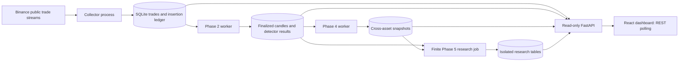
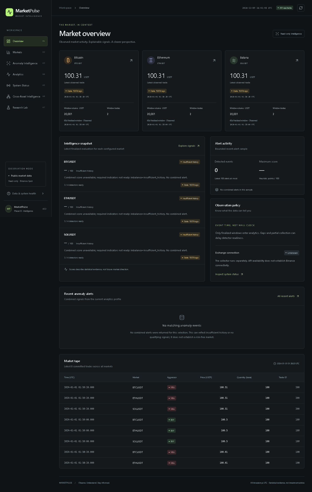
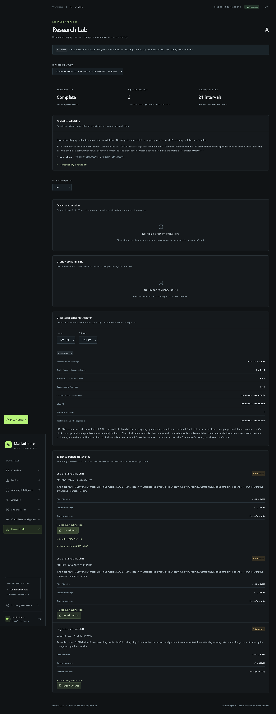

# MarketPulse

**Real-time cryptocurrency anomaly intelligence and reproducible market research.**
## Off Campus
Off Campus Code: JH4QY4

MarketPulse collects public Binance trades for BTCUSDT, ETHUSDT and SOLUSDT,
builds event-time market analytics, explains unusual observations, and studies
changing cross-asset relationships. A responsive React dashboard makes the evidence,
coverage and statistical limitations inspectable.

The project implements Phases 1?5. It does not execute trades, manage wallets, use
exchange credentials, train predictive models or provide investment recommendations.
No private database, operational capture or live discovery is included in this repository.

## Features

| Phase | Capabilities |
| --- | --- |
| 1 ? Collection | Validated Binance WebSocket trades, bounded ingestion, retry/backoff, deduplicated SQLite persistence and read-only API |
| 2 ? Anomaly analytics | Finalized event-time OHLCV/VWAP, realized volatility, aggressive imbalance, log returns, four robust detectors and explainable heuristic risk scores |
| 3 ? Dashboard | Overview, interactive markets/charts, anomaly evidence, analytics and system status; REST polling, UTC labels and explicit unavailable states |
| 4 ? Cross-asset intelligence | Eligible return alignment, rolling correlations, relationship changes, lead?lag association, market regimes and signed network visualization |
| 5 ? Research validation | Frozen-input replay, discrepancy retention, detector/episode evaluation, robust CUSUM changes, chronological embargoes, sequence research, block resampling and multiplicity safeguards |

## Architecture



These are tables in one configured SQLite database, accessed by separate processes
using WAL mode. Workers use durable checkpoints, bounded batches and versioned
policy identities. The API does not start collection or research jobs.

**Backend:** Python, FastAPI, Pydantic, SQLite, websockets and standard-library
statistics. **Frontend:** React, TypeScript, Vite, Tailwind CSS, TanStack Query,
React Router, TradingView Lightweight Charts and Lucide. **Tests:** pytest,
Ruff, Vitest, React Testing Library, MSW and Playwright/Chrome.

## Requirements

- Python 3.11 or newer. The pinned backend environment was verified with Python 3.14.
- Node.js 22.12 or newer and npm; Node.js 24 is the verified development version.
- Git for cloning and the publication audit.
- Internet access for dependency installation and optional public Binance collection.
- Installed Google Chrome for the optional browser suite.

Tests and the browser demonstration use explicitly synthetic temporary data. They
do not require a Binance account, API key, private database or access to the exchange.

## Local installation

Clone or download the repository into a local directory. For sustained collection,
keep the SQLite database on an unsynchronized local filesystem; avoid cloud-synced
folders and network shares. See [database storage and backup](docs/database_relocation.md).

### Windows PowerShell

From the repository root:

```powershell
py -3 -m venv .venv
.\.venv\Scripts\Activate.ps1
python -m pip install -r requirements-lock.txt
python -m pip install --no-deps -e .
npm --prefix frontend ci

# Preserve existing local configuration; never overwrite it with the example.
if (-not (Test-Path .env)) { Copy-Item .env.example .env }
if (-not (Test-Path frontend/.env)) { Copy-Item frontend/.env.example frontend/.env }
```

If script execution is restricted, use `.\.venv\Scripts\python.exe` in place of
`python` rather than changing machine-wide execution policy.

### Linux / macOS

```bash
python3 -m venv .venv
. .venv/bin/activate
python -m pip install -r requirements-lock.txt
python -m pip install --no-deps -e .
npm --prefix frontend ci
[ -e .env ] || cp .env.example .env
[ -e frontend/.env ] || cp frontend/.env.example frontend/.env
```

The lockfile records the verified environment. `python -m pip install -e '.[dev]'`
is an alternative dependency-range installation, rather than the exact pinned set.
Other Python/OS combinations require their own validation.

## Configuration

Run backend commands from the repository root, with the virtual environment active
in each terminal. Settings load `.env`; process environment variables take precedence.

| Setting | Default / role |
| --- | --- |
| `MARKETPULSE_DATABASE_PATH` | `data/marketpulse.sqlite3`; choose your own local storage path for sustained use |
| `MARKETPULSE_SYMBOLS` | `BTCUSDT,ETHUSDT,SOLUSDT` |
| `MARKETPULSE_ANALYTICS__*` | Phase 2 window, lateness, baseline and detector policy |
| `MARKETPULSE_CROSS_ASSET__*` | Cross-asset lookbacks, coverage, baselines and research policy |
| `MARKETPULSE_API_TARGET` | Frontend Vite development/preview proxy target, normally `http://127.0.0.1:8000` |
| `VITE_API_BASE_URL` | Empty for same-origin requests; public browser configuration |

All backend services must select the same database and source policies. Both
environment examples contain safe development defaults. Never put secrets in a
`VITE_*` variable: Vite exposes those values to the browser. Keep `.env` private.

## Database initialization and migrations

For a **new installation only**, initialize the configured database without
starting a server or exchange connection:

```bash
python scripts/initialize_database.py
```

This refuses an existing file. Normal repository startup also installs the additive
Phase 1?4 schema through version 3 when creating a database. Existing data is not
replaced. Research schema 4 requires its explicit, verified-backup migration.

Before migrating an existing installation, arrange a controlled graceful shutdown
and obtain the owner's approval. Do not run migrations against another person's
running services. For a new installation, perform this step before starting services:

```powershell
# PowerShell: derive the actual selected path rather than assuming a local filename.
$dbPath = python -c "from marketpulse.config import Settings; print(Settings().database_path.resolve())"
python -m marketpulse.research.cli migrate --database "$dbPath" --backup data/backups/before-research.sqlite3
```

```bash
# Bash equivalent:
dbPath="$(python -c 'from marketpulse.config import Settings; print(Settings().database_path.resolve())')"
python -m marketpulse.research.cli migrate --database "$dbPath" --backup data/backups/before-research.sqlite3
```

The backup destination must not already exist. Migration verifies integrity and
original table content hashes and preserves production profiles/checkpoints. Do not
delete an existing backup to reuse the example name; choose a new destination.
See the [activation checklist](docs/phase5_activation.md) for controlled operation
and the [research guide](docs/research_validation.md) for schema details.

## Run locally

Start **one instance of each service**, in separate terminals. Check for existing
instances first. Never restart an existing installation just to follow this guide.

```bash
# Terminal 1 ? public trade collector; this connects to Binance.
python -m marketpulse.ingestion.cli

# Terminal 2 ? event-time analytics.
python -m marketpulse.analytics.cli --watch

# Terminal 3 ? incremental cross-asset analytics.
python -m marketpulse.cross_asset.cli --watch

# Terminal 4 ? local read-only API.
python -m uvicorn marketpulse.api.app:create_app --factory --host 127.0.0.1 --port 8000

# Terminal 5 ? dashboard.
npm --prefix frontend run dev
```

Open the [dashboard](http://127.0.0.1:5173), [API documentation](http://127.0.0.1:8000/docs)
or [health endpoint](http://127.0.0.1:8000/health). The frontend proxies `/api` and
`/health` to the local API. Starting only the API and frontend is valid: a new
database displays empty and insufficient-history states until observations exist.

Use Ctrl+C for graceful shutdown. Stop collection first, allow workers to catch up,
then stop workers and the API. Closing the collector does not finalize its last
window merely because wall time advances; the event-time watermark governs readiness.

## Dashboard and Research Lab

| Page | Purpose |
| --- | --- |
| Overview | Observed market prices, activity, freshness and recent alerts |
| Markets | Candlesticks, volume histograms and recent trades |
| Anomaly Intelligence | Detector contributions, scores and signal explanations |
| Analytics | Volume, volatility, imbalance and returns |
| System Status | Database/API access and processing freshness; unknown connectivity stays explicit |
| Cross-Asset Intelligence | Correlation matrix/history, signed network, lead?lag and regimes |
| Research Lab | Historical experiments, detector evaluation, CUSUM evidence, sequence support and discoveries |

Research is a deliberate finite job. Choose a bounded UTC grid-aligned range that
all source symbols have finalized; inspect `/api/cross-asset/status` for the safe
frontier. Replace the start/end placeholders with your own available history:

```bash
python -m marketpulse.research.cli run --store "$dbPath" \
  --start "START_UTC" --end "END_UTC" --batch 128 --max-batches 10
```

In PowerShell, put the command on one line or use backticks for continuation.
Research jobs resume by deterministic identity. An empty database cannot produce
real research findings; fixture demonstrations are separate from production data.
The [23 read-only routes](docs/dashboard.md#api-overview) include seven original,
seven cross-asset and nine versioned research endpoints.

## Tests and contract checks

Run from the repository root; these commands use temporary synthetic databases:

```bash
python -m pytest -q
python -m ruff check .
python -m ruff format --check .
python frontend/scripts/export_openapi.py --check
python frontend/scripts/export_test_fixtures.py --check
python frontend/scripts/export_cross_fixtures.py --check
python frontend/scripts/export_research_fixtures.py --check
npm --prefix frontend run typecheck
npm --prefix frontend run lint
npm --prefix frontend test
npm --prefix frontend run build
```

If a shared operating-system pytest directory has an ownership/permission conflict,
use `--basetemp` with a **new empty** directory beneath ignored `data/test-runs/`.
Pytest manages that directory; never point it at an existing database or backup.

After intentional API changes, export without `--check`, run
`npm --prefix frontend run api:generate`, regenerate relevant fixtures and review
the changes. `frontend/openapi.json` and generated TypeScript types are committed
contracts; build bundles and browser output are excluded.

The optional isolated browser suite needs installed Google Chrome and free ports
8001/5174. It refuses occupied ports, creates temporary synthetic data and shuts
down only its own test services:

```bash
python frontend/scripts/research_browser_check.py
```

It does not start a collector or analytics watch process and does not use an
existing database. See [publication readiness](docs/github_readiness.md) for the
latest recorded verification and clean-export checks.

## Screenshots

These images demonstrate **synthetic fixture data**, not live prices, real
discoveries or predictive performance. They contain no local paths or operator records.





## Statistical limitations

- Only eligible completed observations enter discovery. Missing, partial and
  gap-affected data are not forward-filled into synchronized returns.
- Overlapping windows are dependent. Counts are not independent effective sample sizes.
- Detector scores and CUSUM thresholds are heuristic indicators, not calibrated probabilities.
- Sequence inference requires support, coverage, chronological holdouts and stated
  bootstrap/null assumptions. Multiple-testing correction cannot fix an invalid null.
- Unlabeled flag frequency is not a false-positive rate. Precision, recall, F1 and
  accuracy require defensible independent labels and are not invented here.
- Correlation, lead?lag and temporal association do not establish causation,
  profitable predictability, contagion or crash forecasts.
- API reachability is not proof of an active exchange connection. Continuous
  collection, exchange-clock completeness and long-term throughput need separate validation.

This is local descriptive research software, not financial advice. Public hosting,
authentication, trading functionality and Phase 6 are outside the implemented scope.

## Documentation

- [Phase 2 analytics](docs/analytics.md)
- [Dashboard and API](docs/dashboard.md)
- [Cross-asset methods](docs/cross_asset_intelligence.md)
- [Research validation](docs/research_validation.md)
- [Storage, backups and relocation](docs/database_relocation.md)
- [Controlled activation](docs/phase5_activation.md)
- [GitHub readiness and safe publishing](docs/github_readiness.md)

## Contributors

- **Daneesh**
- **Tejas**

No license has been selected in this repository. The contributors should choose
and approve licensing terms before adding a license file.
